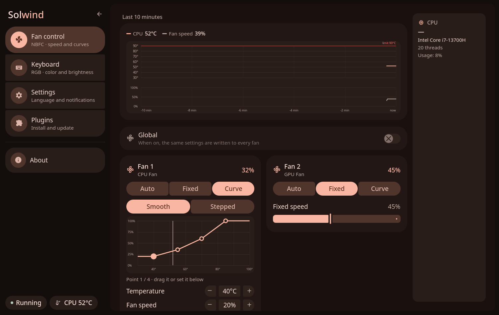
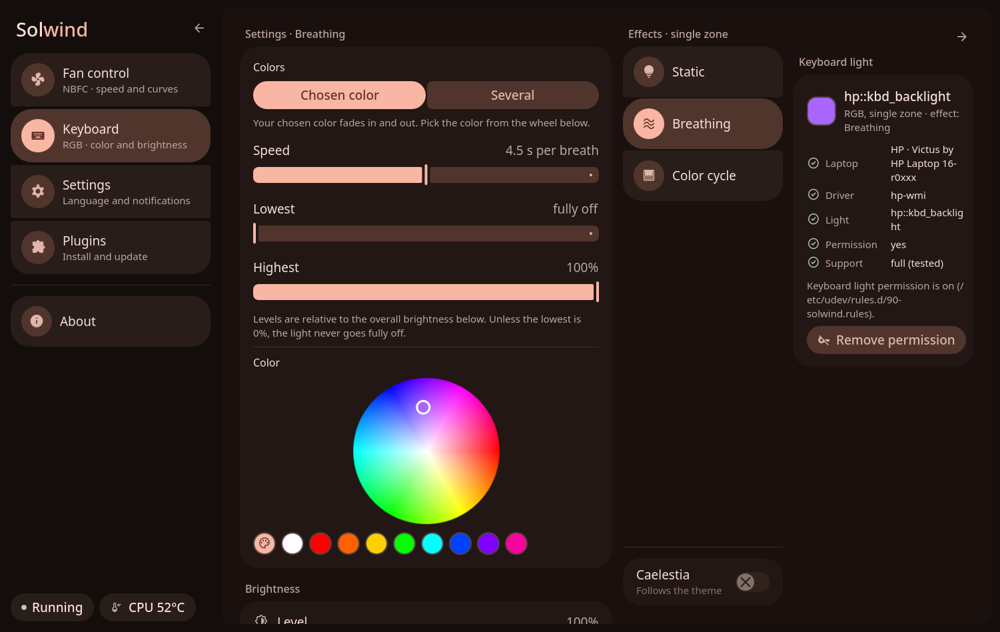
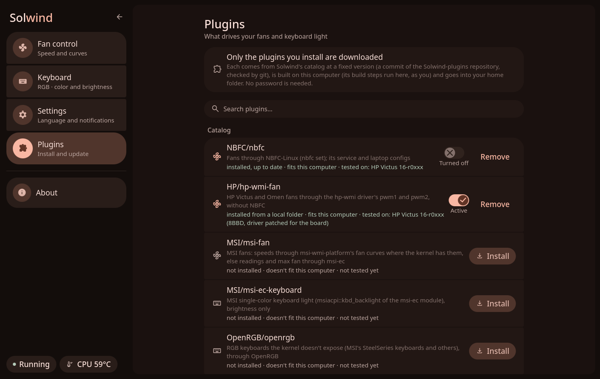

# Solwind

A small control center for laptops: **fan control** and **keyboard lighting**, with a window made with [Quickshell](https://quickshell.org) to fit right into [Caelestia dots](https://github.com/caelestia-dots).

It has two parts: **solwindd**, a small background service (C++/Qt) that drives the fans and the keyboard light, and the **window**, which only shows and changes what solwindd does. The fans don't need the window; the terminal commands and [your own tools](docs/DBUS.md) talk to solwindd too.

> [!NOTE]
> I used AI assistance while building this project. I reviewed parts of the code myself and tested the features my own laptop has before publishing it.

> [!WARNING]
> **This is an early project, use it at your own risk.**
>
> - I've only tested it on my own **HP Victus 16-r0xxx** (Arch Linux, Hyprland). Other models and brands may not work.
> - The fan part **writes fan speeds to your hardware**, through NBFC or the HP driver. A bad setting can make your laptop run hot, so keep an eye on the temperatures.
> - If solwindd crashes, its systemd service hands the fans back to automatic control and starts it again. By hand: `nbfc set -a` with NBFC, `solwind fan-permission off` with the HP plugin.

## Screenshots

| Fan control | Keyboard | Plugins |
|---|---|---|
|  |  |  |

Colors follow your Caelestia theme. A narrow window shows everything in one column.

## Features

**Fans** (through [NBFC-Linux](https://github.com/nbfc-linux/nbfc-linux) with the `NBFC/nbfc` plugin, or the HP driver with `HP/hp-wmi-fan`):
- Per fan: **Auto** (NBFC or the firmware decides), **Fixed** or **Curve** (following the CPU, the GPU or the hotter one)
- Curve editor, profiles (Quiet, Balanced, Performance and your own), max fan button, a 10 minute graph
- Speeds up right away, slows down gently. Above the safety limit (90 °C unless you change it) every fan it controls goes to 100%
- NBFC service controls and config picker, notifications, tray icon

**Keyboard** (a plugin per kind of light):
- Color, brightness, breathing and color cycle effects (also with your Caelestia theme colors)
- Detects your laptop and light, and only shows what your keyboard can do (`solwind kbd info`)

English and Turkish. Colors, rounding and fonts come from your Caelestia setup; Solwind only reads Caelestia's files.

### Supported keyboards

Each kind of light has its own plugin (see [Plugins](#plugins)). Solwind only uses the files a kernel driver offers in `/sys`, never the firmware or USB directly. Only the first row is tested on real hardware.

| Laptop | Plugin | Kernel light | What works |
|---|---|---|---|
| HP Victus / OMEN, single-zone RGB | `HP/hp-wmi-keyboard` | `hp::kbd_backlight` (extra module, [see below](#hp-laptops)) | Color, brightness, effects |
| HP OMEN / Victus, four-zone RGB | `HP/hp-wmi-keyboard-zones` | `hp::kbd_zoned_backlight-*` or `hp::kbd_backlight_zone0`–`3` (extra module) | Color (same on all zones), brightness |
| HP OMEN / Victus, four-zone RGB | `HP/hp-wmi-rgb-zones` | `rgb_zones/zone00`–`zone03` (older copies of the module) | Color only, same on all zones |
| ASUS, Lenovo, Chromebooks and others | none yet | | Earlier versions had built-in support for ASUS TUF colors and other brands' brightness (only tried with a fake `/sys`). They'll come back as plugins once I've looked into each driver again. |
| ASUS ROG, Lenovo Legion RGB | — | colors go through USB | Not through the kernel; use [asusctl](https://gitlab.com/asus-linux/asusctl) / [L5P-Keyboard-RGB](https://github.com/4JX/L5P-Keyboard-RGB) for colors |
| MSI, single color | `MSI/msi-ec-keyboard` | `msiacpi::kbd_backlight` (needs the [msi-ec](https://github.com/BeardOverflow/msi-ec) module, the one in the official kernel doesn't have it) | Brightness, not tested |
| MSI RGB (SteelSeries) and other RGB keyboards [OpenRGB](https://openrgb.org) supports | `OpenRGB/openrgb` | none, through OpenRGB | One color and brightness, no software effects, not tested on hardware. Install OpenRGB; Solwind starts its server on 127.0.0.1 if it isn't running |
| HP per-key RGB, HP white backlight, other OMEN modules | — | not offered by the kernel or the module | — |

Effects are only on for the HP single-zone keyboard, the one I could test them on.

### HP laptops

- **Keyboard colors** need the extra kernel module [hp-wmi-fan-and-backlight-control](https://github.com/TUXOV/hp-wmi-fan-and-backlight-control); the official kernel doesn't support HP keyboard lights yet (as of Linux 7.3). It only helps RGB keyboards.
- **Fans** need NBFC with a config for your exact model (and the `NBFC/nbfc` plugin). Configs using ACPI methods also need `acpi_call` (`acpi_call-dkms` on Arch).

```sh
git clone https://github.com/TUXOV/hp-wmi-fan-and-backlight-control
cd hp-wmi-fan-and-backlight-control
make install-arch          # Arch (DKMS package); other distros: make && sudo make install-dkms
```

Reboot, then `ls /sys/class/leds | grep hp::` should list the light. Remove older copies of the module first (`dkms status`). Undo on Arch: `sudo pacman -R hp-wmi-fan-and-backlight-control-dkms`. Only the `HP/hp-wmi-fan` plugin uses the module's fan controls.

## Installation

### Requirements

| Needed | Arch package |
|---|---|
| [Quickshell](https://quickshell.org) 0.3.x | `quickshell` / `quickshell-git` (AUR) |
| [Caelestia shell](https://github.com/caelestia-dots/shell) (Solwind won't start without it) | `caelestia-shell` (AUR) |
| Material Symbols font | `ttf-material-symbols-variable` |
| [NBFC-Linux](https://github.com/nbfc-linux/nbfc-linux) with a config for your laptop (fans, unless you use the HP fan plugin) | `nbfc-linux` (AUR) |
| A polkit agent (password dialogs) | e.g. `hyprpolkitagent` |
| Optional: tray icon, NVIDIA temperature, GPU names | `python-gobject`, `nvidia-utils`, `pciutils` |
| To build solwindd and its plugins: CMake, Qt 6 (base and declarative, 6.5 or newer; I use 6.12), a C++20 compiler; git (plugins are downloaded with it) | `cmake`, `qt6-base`, `qt6-declarative`, `base-devel`, `git` |
| systemd (the background service runs as a systemd user service) | `systemd` |

### NBFC

Solwind tells NBFC what to do, NBFC talks to the laptop. Set it up first ([full guide](https://github.com/nbfc-linux/nbfc-linux#readme)):

```sh
sudo nbfc update                       # download the laptop configs
nbfc config -r                         # configs that may fit your laptop
sudo nbfc config -s "<config name>"
sudo nbfc start --read-only            # try it safely: it only reads
nbfc status -a                         # do the fans and temperature look right?
sudo nbfc restart && sudo systemctl enable nbfc_service
```

If no config fits, don't force one. The keyboard part works without NBFC.

**MSI fans (`MSI/msi-fan`):** with the `msi-wmi-platform` fan curve patches in your kernel, which aren't in the official kernel yet, you get Fixed, Curve and profiles. Without them, with the [msi-ec](https://github.com/BeardOverflow/msi-ec) module, you get readings, Auto and max fan, because `msi-ec` can't set a speed. Solwind never writes the embedded controller directly. Not tested on hardware. One person reported hard resets on one MSI with custom curves outside the high performance profile, cause not confirmed, so go carefully. Same steps as below with `solwind plugin install MSI/msi-fan`.

**HP fans without NBFC:** `HP/hp-wmi-fan` drives the fans through the same module's `pwm1` and `pwm2`, on the boards the module opens those files on. No NBFC, no config, and the two fans really run at their own speeds. I tested it on one board only (8BBD, with the module patched for that board, since the board isn't on its list). If your firmware ignores the command the fans just stay on automatic.

```sh
solwind plugin disable NBFC/nbfc           # if you had it: the NBFC plugin comes first
solwind quit                               # hands the fans back while NBFC still runs
sudo nbfc stop                             # both can't drive the same fans
sudo systemctl disable nbfc_service
solwind plugin install HP/hp-wmi-fan
solwind fan-permission                     # lets your user write the fan speed
solwind
```

Things that work differently from NBFC:

- The driver has one mode for both fans. A fan on Auto next to a Fixed or Curve fan runs at that fan's speed; real automatic control needs both on Auto.
- The lowest speed is about 2000 RPM, so 0% doesn't stop the fans. Only automatic control can.
- Fan settings are kept apart from NBFC's. Back to NBFC: `solwind quit`, `solwind fan-permission off`, `solwind plugin remove HP/hp-wmi-fan`, `solwind plugin enable NBFC/nbfc`, `sudo systemctl enable --now nbfc_service`, `solwind`.

### Install

```sh
git clone https://github.com/kerimozgurtukenmez/Solwind.git
cd Solwind
make                  # builds solwindd (without sudo)
sudo make install
```

It goes under `/usr/local` (command, solwindd, app, menu entry, icon, systemd user services, and the headers plugins are built against). Then install the [plugins](#plugins) for your laptop, and open **Solwind** from the app launcher or run `solwind`. On a first install the launcher may only show it after you log in again or restart the shell.

- **Update:** `git pull`, `make`, `solwind quit`, `sudo make install`, `solwind plugin update`, then `solwind` (`make install` prints the command if you use the background service).
- **Uninstall:** `solwind quit`, then `sudo make uninstall`. Turn the background service off first; it tells you if you forgot. Your settings stay in `~/.config/solwind`, your plugins in `~/.local/share/solwind/plugins`.
- **Packaging:** `make DESTDIR=/package/root PREFIX=/usr install`.

`make install` stops without changing anything while Solwind runs or when it finds an older install in your home folder.

**Coming from Solwind 0.5 or older:** `solwind quit`, then `make` and `sudo make install` as above. Your settings stay as they are. If you had "Start in the background on login" on, it now starts solwindd; run `systemctl --user daemon-reload` once (`make install` reminds you).

**Coming from Ccenter** (Solwind's old name) or an older Solwind installed with `install.sh`: remove that copy first, without sudo, then install. Your settings are copied over on the first start.

```sh
ccenter quit        # or: solwind quit
make remove-old     # shows what it removes and asks
sudo make install
```

Keybinds or scripts that use `ccenter` need `solwind` now.

### Plugins

Solwind itself only reads the temperatures. What it drives comes from plugins, and **none comes with it**: you install the ones for your laptop. They live in their own repository, [Solwind-plugins](https://github.com/kerimozgurtukenmez/Solwind-plugins), and only the ones you install are downloaded.

```sh
solwind plugins                            # every plugin, which are installed, which fit this computer
solwind plugin install NBFC/nbfc           # fans through NBFC
solwind plugin install HP/hp-wmi-keyboard  # an HP single-zone RGB keyboard (see the table above for the others)
solwind plugin install HP/hp-wmi-fan       # HP fans without NBFC (see HP laptops)
solwind plugin install OpenRGB/openrgb     # RGB keyboards through OpenRGB, MSI's among them
solwind quit; solwind                      # solwindd loads plugins when it starts
```

`solwind plugin install` takes the plugin's commit from Solwind's catalog (`plugin-catalog.json` in this repository), downloads only that plugin's folder at exactly that commit with git (git checks the commit id, so it's exactly the code the catalog names), builds it against the installed Solwind and puts it into `~/.local/share/solwind/plugins`. No sudo; it needs `git` and `cmake`. `solwind plugin update` brings installed plugins to the catalog's commits and builds them again after a Solwind update; `solwind plugin remove <name>` removes one; `solwind plugin disable <name>` turns one off without removing it (`enable` turns it on again; both take effect when solwindd starts again). `solwind report` and `busctl --user get-property solwind.Daemon /solwind solwind.Daemon Plugins` show which ones solwindd loaded.

- A plugin runs inside solwindd, as your user. Only the plugins in the catalog of the Solwind you cloned are offered. The commit ids pin the code, but a catalog is only as trustworthy as my GitHub account (there's no signature).
- solwindd loads a plugin only if it was built for this Solwind (the same version and plugin interface), and only if no one but you (or root) can change the file or the plugin folders it is in (a link is refused too). After an update, run `solwind plugin update`: until then solwindd skips them and says why.
- Without a fan plugin the fan page only shows the temperatures and nothing is ever sent to NBFC; without a keyboard plugin the Keyboard page says which light it found.

### Permissions

- **Keyboard light (optional):** your user needs write access to the light's files. Use **Grant permission** on the Keyboard page (or `sudo make udev`); **Remove permission** undoes it. Only your user gets access.
- **HP and MSI fans (only with `HP/hp-wmi-fan` or `MSI/msi-fan`):** `solwind fan-permission` adds `/etc/udev/rules.d/91-solwind-fans.rules`, which gives your user the fan files of the HP and MSI drivers. Any program of yours can then set the fan speed. `solwind fan-permission off` removes it and puts the fans on automatic.
- **NBFC service actions** (start, stop, applying a config) ask for your password every time. Setting fan speeds doesn't.

## Usage

- `solwind` (or the menu entry) starts solwindd if it isn't running and opens the window.
- Closing the window doesn't stop solwindd, it keeps controlling the fans. Quit everything with **Quit** in Settings, the tray menu or `solwind quit`; the fans go back to automatic control and the keyboard stays on its chosen color.
- **Start in the background on login** is a switch in the app (it turns the systemd user service `solwind.service` on). If solwindd crashes, systemd hands the fans back the way the fan plugin in use said when it started (NBFC: `nbfc set -a`; without a fan plugin nothing is done, the firmware keeps the fans) and starts solwindd again. The tray icon comes with it (it ends by itself if you turn the tray off).
- The terminal commands work without the window.

```sh
solwind status              # fans, temperatures, active profile
solwind profile quiet       # apply a profile (no name: show the active one)
solwind boost 15            # max fan for 15 minutes (on / off)
solwind kbd color "#ff0000" # also: brightness, effect, source, speed, range, info
solwind log -f              # follow solwindd's log
solwind --help              # everything; solwind help kbd for one command
```

Exit codes: 0 done, 1 error, 2 wrong usage, 3 not started (already running, or an old Solwind app drives the fans), 4 not running. For a Hyprland keybind: `hl.bind("SUPER + F9", hl.dsp.exec_cmd("solwind profile performance"))` (`/usr/local/bin` is on Hyprland's `PATH`, at least on mine). The window class is `solwind`.

## Your own UI or scripts

solwindd's whole interface is on D-Bus (the session bus, `solwind.Daemon`): its state as properties with change signals, and methods to change it. The window uses nothing else, so a widget, a bar module or a script can do what it does. See [docs/DBUS.md](docs/DBUS.md). For example:

```sh
busctl --user get-property solwind.Daemon /solwind/Fans solwind.Fans Temp
busctl --user call solwind.Daemon /solwind/Fans solwind.Fans ApplyProfile sb quiet false
```

solwindd checks everything it's sent; the safety limit and handing the fans back are its own, whatever a client does.

## Reporting a problem

Run `solwind report` (or **Create report** in Settings) and attach the file to a [GitHub issue](https://github.com/kerimozgurtukenmez/Solwind/issues). It's one text file in your home folder with versions, your laptop model (no serial numbers), NBFC status, what solwindd detected and reads, your settings and recent logs. Your user name and computer name are replaced, nothing is sent anywhere. Logs are cleared on reboot, so make it before rebooting.

## Undoing things

- Fans back to automatic: `nbfc set -a` with NBFC; with the HP plugin quit Solwind
- Solwind never edits NBFC config files, it only selects one. To go back: `sudo nbfc config --set "<config name>"` and `sudo nbfc restart`
- Keyboard permission: **Remove permission** in the app, or `sudo make uninstall-udev`
- HP fan permission: `solwind fan-permission off`, or `sudo make uninstall-udev`

## Security

- Day-to-day use needs no admin rights: solwindd runs as your user, fan speeds go through `nbfc set` or, with the HP plugin, the driver's files your user was given.
- Admin actions only happen when you click them, through your system's password dialog. Solwind never sees your password.
- The keyboard is only touched through the kernel. The keyboard permission is for your user only, and the rule is checked line by line before it's installed.
- Plugins are code that runs inside solwindd, as your user, and building one runs its build steps on your computer; solwindd skips one that someone else could have changed (see [Plugins](#plugins)).
- NBFC config files and Caelestia's files are never changed.

## Development

`backend/` is solwindd (C++/Qt, CMake) and `solwind-plugin`; the interfaces plugins implement are in `backend/src/plugins/`, `backend/qml/` is the QML module the window uses to talk to it. The plugins are in [Solwind-plugins](https://github.com/kerimozgurtukenmez/Solwind-plugins): clone it next to this one and build both together for the tests (`cmake -S backend -B <dir> -DSOLWIND_PLUGINS_DIR=<Solwind-plugins> && cmake --build <dir> && ctest --test-dir <dir>`; without it only the tests that don't need a plugin are built). In the window, `services/` only passes solwindd's state to the pages in `modules/`. Run it from the cloned folder with `make` and `./bin/solwind` (quit the installed copy first): solwindd then runs as a temporary systemd service with the same hand-back, with the plugins of the build (if it has them) and the ones in your home folder. UI text is English in the code, wrapped in `I18n.t(…)`, with the Turkish text in `services/translations.js` (solwindd uses the same file).

## Thanks

[Caelestia](https://github.com/caelestia-dots), [Quickshell](https://quickshell.org), [Qt](https://www.qt.io), [NBFC-Linux](https://github.com/nbfc-linux/nbfc-linux) and everyone who made laptop configs for it, and [Material Symbols](https://fonts.google.com/icons).

## License

Copyright (C) 2026 Kerim Özgür Tükenmez

Solwind is free software under the **GNU General Public License version 3**, without any warranty; see [`LICENSE`](LICENSE).

The transparency math in `services/Colours.qml` is adapted from [Caelestia shell](https://github.com/caelestia-dots/shell) (GPL-3.0), whose QML plugin Solwind uses at runtime (not included). Quickshell (LGPL-3.0), Qt (LGPL-3.0), NBFC-Linux (GPL-3.0) and Material Symbols (Apache-2.0) are separate and not included.

Solwind is an independent project, not made or supported by the Caelestia, Quickshell or NBFC developers or any laptop maker. Please report Solwind problems here.
